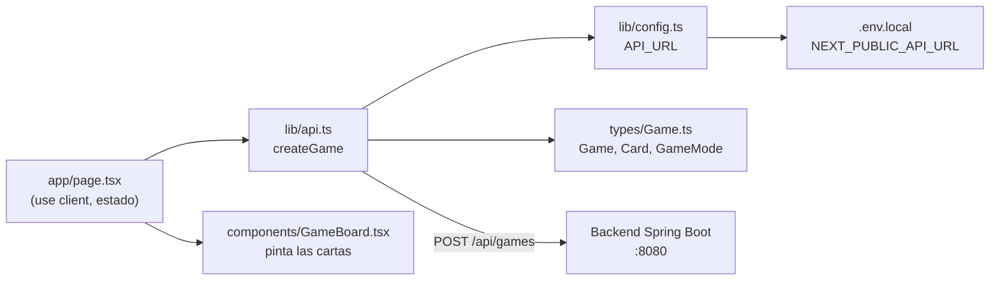
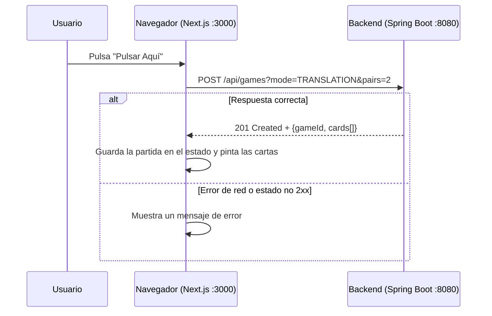
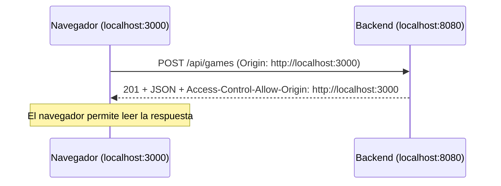

# 🃏 Phrasal Verbs Memory Game — Frontend

Aplicación web para practicar phrasal verbs en inglés mediante un juego de emparejar cartas. Este repositorio contiene el **frontend**; el backend (Spring Boot) está en un repositorio aparte.

> **Estado:** en desarrollo. Ya puedes crear una partida desde la página: el frontend pide `POST /api/games` al backend y pinta las cartas en una cuadrícula, con estados de carga y de error. Todavía no se pueden voltear las cartas ni validar parejas.

## 🛠️ Stack

- Next.js 16 (App Router)
- React 19
- TypeScript
- Tailwind CSS 4
- Prettier (con plugin de Tailwind) y ESLint (con `eslint-plugin-tailwindcss`)

## 📋 Requisitos previos

- Node.js compatible con Next.js 16
- npm
- Git
- Backend en marcha en `http://localhost:8080`, configurado para aceptar peticiones desde `http://localhost:3000` (CORS)

## 🚀 Puesta en marcha

1. Clona este repositorio y entra en la carpeta del proyecto:

   ```bash
   git clone <URL_DEL_REPOSITORIO>
   cd phrasal-verbs-frontend
   ```

2. Instala las dependencias:

   ```bash
   npm install
   ```

3. Crea tu archivo de entorno a partir de la plantilla:

   ```bash
   cp .env.example .env.local
   ```

   Ajusta `NEXT_PUBLIC_API_URL` si tu backend no está en `http://localhost:8080`.

4. Inicia el servidor de desarrollo:

   ```bash
   npm run dev
   ```

5. Abre [http://localhost:3000](http://localhost:3000) y pulsa **Pulsar Aquí**: aparecerán 4 cartas (2 parejas) mezcladas. Si el backend está apagado, verás un mensaje de error.

## ⚙️ Variables de entorno

| Variable              | Descripción                           | Ejemplo                 |
| --------------------- | ------------------------------------- | ----------------------- |
| `NEXT_PUBLIC_API_URL` | URL base del backend, sin barra final | `http://localhost:8080` |

`.env.local` no se sube a git; `.env.example` sí, como plantilla. Si la variable no está definida, la aplicación falla al arrancar con un mensaje claro (ver `src/lib/config.ts`).

## 📜 Scripts disponibles

| Comando         | Descripción                      |
| --------------- | -------------------------------- |
| `npm run dev`   | Inicia el servidor de desarrollo |
| `npm run build` | Genera la versión de producción  |
| `npm run start` | Sirve la versión de producción   |
| `npm run lint`  | Ejecuta ESLint                   |

## ✨ Calidad de código

- **Prettier:** formatea el código y, con su plugin de Tailwind, ordena las clases. La configuración está en `.prettierrc`. Para formatear todo: `npx prettier --write src`.
- **ESLint:** `npm run lint`. Incluye `eslint-plugin-tailwindcss`, que avisa de clases de Tailwind que no existen (`no-custom-classname`). El orden de las clases lo hace Prettier, así que esa regla de ESLint está desactivada.

## 🧩 Estructura del proyecto

```text
src/
├── app/
│   ├── page.tsx        Página principal: botón para crear partida y estados de carga y error
│   ├── layout.tsx      Layout y metadatos globales
│   └── globals.css     Estilos globales y configuración de Tailwind
├── components/
│   └── GameBoard.tsx   Pinta las cartas de la partida en una cuadrícula
├── lib/
│   ├── api.ts          Llamadas al backend (createGame)
│   └── config.ts       Lectura y validación de la URL de la API
└── types/
    └── Game.ts         Tipos de partida, carta y modo de juego
```

## 🔄 Cómo se comunica con el backend



Los componentes nunca llaman a `fetch` directamente: toda la comunicación con el backend pasa por `src/lib/api.ts`. La página guarda la partida, el estado de carga y el error en el estado de React, y pasa solo las cartas a `GameBoard`.

Flujo de una petición:



## 🔐 CORS

`localhost:3000` (front) y `localhost:8080` (backend) son **orígenes distintos**. El navegador solo deja que el JavaScript del front lea la respuesta si el backend la acompaña de la cabecera `Access-Control-Allow-Origin`:



- Es una protección **del navegador**: `curl` y Postman no la aplican, por eso allí la llamada funcionaba incluso antes de configurarla.
- La solución está en el **backend**: autoriza el origen del front, que se configura con la variable `CORS_ORIGIN` (por defecto `http://localhost:3000`).

## 🃏 Tipos de datos

En `src/types/Game.ts` están los tipos que reflejan, campo por campo, la respuesta del backend:

```ts
export type Card = {
  id: string;
  text: string;
};

export type Game = {
  gameId: string;
  cards: Card[];
};
```

`GameMode` es una unión de strings con los modos disponibles (hoy solo `"TRANSLATION"`). Las cartas no incluyen la solución: el backend nunca la envía.

> TypeScript no valida lo que llega por la red: si el backend cambia el JSON y estos tipos no se actualizan, el compilador no avisará. El contrato lo mantenemos a mano.

## 📚 Conceptos aplicados

| Concepto                             | Dónde se usa                                                   | Documentación                                                                                                       |
| ------------------------------------ | -------------------------------------------------------------- | ------------------------------------------------------------------------------------------------------------------- |
| Origen y CORS                        | El front y el backend están en puertos distintos               | [MDN: CORS](https://developer.mozilla.org/es/docs/Web/HTTP/Guides/CORS)                                             |
| Verbos HTTP y códigos de estado      | `POST` crea la partida y devuelve 201; un `GET` da 405         | [MDN: 405](https://developer.mozilla.org/es/docs/Web/HTTP/Reference/Status/405)                                     |
| `fetch` y `res.ok`                   | `fetch` no lanza error con un 4xx/5xx; hay que comprobarlo     | [MDN: Fetch](https://developer.mozilla.org/es/docs/Web/API/Fetch_API/Using_Fetch)                                   |
| `URLSearchParams`                    | Construye `?mode=...&pairs=...` sin concatenar a mano          | [MDN: URLSearchParams](https://developer.mozilla.org/es/docs/Web/API/URLSearchParams)                               |
| `async` / `await` y promesas         | `createGame` devuelve `Promise<Game>`                          | [MDN: async function](https://developer.mozilla.org/es/docs/Web/JavaScript/Reference/Statements/async_function)     |
| Variables `NEXT_PUBLIC_`             | Se incrustan en el JavaScript del navegador: nunca van secretos | [Next.js: variables de entorno](https://nextjs.org/docs/app/guides/environment-variables)                           |
| Componentes de servidor y de cliente | `"use client"` permite usar estado y `onClick`                 | [Next.js: Server and Client Components](https://nextjs.org/docs/app/getting-started/server-and-client-components)   |
| Estado con `useState`                | La partida, la carga y el error se guardan en el estado        | [React: useState](https://react.dev/reference/react/useState)                                                       |
| Listas y `key`                       | `GameBoard` pinta las cartas con `key={card.id}`               | [React: Rendering Lists](https://react.dev/learn/rendering-lists)                                                   |
| Renderizado condicional              | Se muestra el tablero, el error o un mensaje según el estado   | [React: Conditional Rendering](https://react.dev/learn/conditional-rendering)                                       |
| Cuadrículas con Tailwind             | Las cartas se colocan en 2 columnas                            | [Tailwind: grid-template-columns](https://tailwindcss.com/docs/grid-template-columns)                               |
| Tipos de unión en TypeScript         | `GameMode` impide pedir un modo que no existe                  | [TypeScript: Union Types](https://www.typescriptlang.org/docs/handbook/2/everyday-types.html#union-types)          |

## 🗺️ Próximos pasos

- Voltear cartas al pulsarlas.
- Validar las parejas contra el backend.
- Incorporar los modos de práctica previstos: traducción, opuestos, sinónimos y completar huecos.
