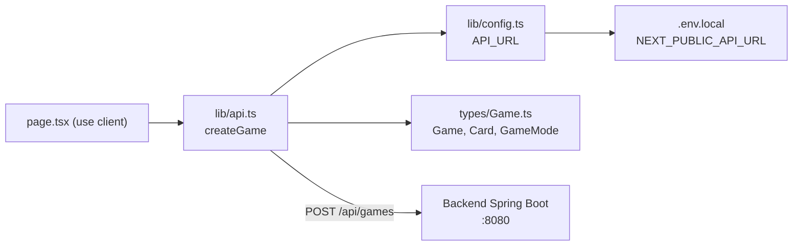
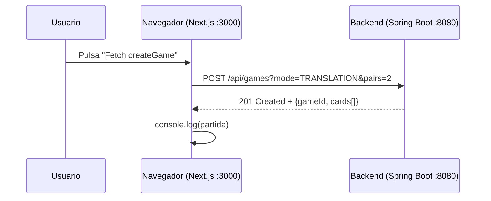
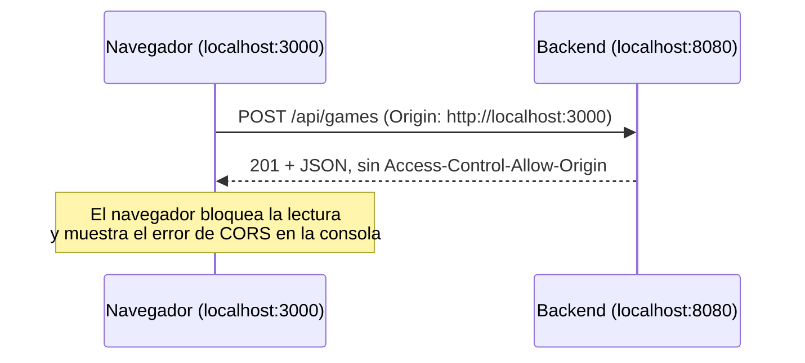

# 🃏 Phrasal Verbs Memory Game — Frontend

Aplicación web para practicar phrasal verbs en inglés mediante un juego de emparejar cartas. Este repositorio contiene el **frontend**; el backend (Spring Boot) está en un repositorio aparte.

> **Estado:** en desarrollo. El frontend ya sabe pedir una partida nueva al backend (`POST /api/games`), pero **el navegador bloquea la respuesta por CORS** hasta que el backend autorice el origen `http://localhost:3000`. La interfaz del juego todavía no existe: solo hay un botón de prueba que muestra el resultado en la consola.

## 🛠️ Stack

- Next.js 16 (App Router)
- React 19
- TypeScript
- Tailwind CSS 4

## 📋 Requisitos previos

- Node.js compatible con Next.js 16
- npm
- Git
- Backend en marcha en `http://localhost:8080` (para probar la llamada)

## 🚀 Puesta en marcha

1. Clona este repositorio y entra en la carpeta del proyecto:

   ```bash
   git clone <URL_DEL_REPOSITORIO>
   cd phrasal-verbs-frontend
   ```

2. Instala las dependencias:

   ```bash
   npm install
   ```

3. Crea tu archivo de entorno a partir de la plantilla:

   ```bash
   cp .env.example .env.local
   ```

   Ajusta `NEXT_PUBLIC_API_URL` si tu backend no está en `http://localhost:8080`.

4. Inicia el servidor de desarrollo:

   ```bash
   npm run dev
   ```

5. Abre [http://localhost:3000](http://localhost:3000). Con las DevTools abiertas (F12), pulsa **Fetch createGame** y mira la consola.

## ⚙️ Variables de entorno

| Variable | Descripción                           | Ejemplo                 |
| --- | ------------------------------------- | ----------------------- |
| `NEXT_PUBLIC_API_URL` | URL base del backend, sin barra final | `http://localhost:8080` |

`.env.local` no se sube a git; `.env.example` sí, como plantilla. Si la variable no está definida, la aplicación falla al arrancar con un mensaje claro (ver `src/lib/config.ts`).

## 📜 Scripts disponibles

| Comando | Descripción                      |
| --- | -------------------------------- |
| `npm run dev`   | Inicia el servidor de desarrollo |
| `npm run build` | Genera la versión de producción  |
| `npm run start` | Sirve la versión de producción   |
| `npm run lint`  | Ejecuta ESLint                   |

## 🧩 Estructura del proyecto

```text
src/
├── app/
│   ├── page.tsx       Página principal (botón de prueba, componente de cliente)
│   ├── layout.tsx     Layout y metadatos globales
│   ├── globals.css    Estilos globales y configuración de Tailwind
│   └── types/
│       └── Game.ts    Tipos de partida, carta y modo de juego
└── lib/
    ├── api.ts         Llamadas al backend (createGame)
    └── config.ts      Lectura y validación de la URL de la API
```

## 🔄 Cómo se comunica con el backend



Los componentes nunca llaman a `fetch` directamente: toda la comunicación con el backend pasa por `src/lib/api.ts`.

Flujo previsto de una petición correcta:



## 🚧 CORS: el bloqueo actual

`localhost:3000` (front) y `localhost:8080` (backend) son **orígenes distintos**. Mientras el backend no envíe la cabecera `Access-Control-Allow-Origin`, el navegador no deja que el JavaScript del front lea la respuesta:



- Es una protección **del navegador**: `curl` y Postman no la aplican, por eso allí la llamada funciona.
- La solución está en el **backend**, que debe autorizar el origen del front. Está pendiente.

## 🃏 Tipos de datos

En `src/app/types/Game.ts` están los tipos que reflejan, campo por campo, la respuesta del backend:

```ts
export type Card = {
  id: string;
  text: string;
};

export type Game = {
  gameId: string;
  cards: Card[];
};
```

`GameMode` es una unión de strings con los modos disponibles (hoy solo `"TRANSLATION"`). Las cartas no incluyen la solución: el backend nunca la envía.

> TypeScript no valida lo que llega por la red: si el backend cambia el JSON y estos tipos no se actualizan, el compilador no avisará. El contrato lo mantenemos a mano.

## 📚 Conceptos aplicados

| Concepto | Dónde se usa | Documentación |
| --- | --- | --- |
| Origen y CORS | El front y el backend están en puertos distintos | [MDN: CORS](https://developer.mozilla.org/es/docs/Web/HTTP/Guides/CORS) |
| Verbos HTTP y códigos de estado | `POST` crea la partida y devuelve 201; un `GET` da 405 | [MDN: 405](https://developer.mozilla.org/es/docs/Web/HTTP/Reference/Status/405) |
| `fetch` y `res.ok` | `fetch` no lanza error con un 4xx/5xx; hay que comprobarlo | [MDN: Fetch](https://developer.mozilla.org/es/docs/Web/API/Fetch_API/Using_Fetch) |
| `URLSearchParams` | Construye `?mode=...&pairs=...` sin concatenar a mano | [MDN: URLSearchParams](https://developer.mozilla.org/es/docs/Web/API/URLSearchParams) |
| `async` / `await` y promesas | `createGame` devuelve `Promise<Game>` | [MDN: async function](https://developer.mozilla.org/es/docs/Web/JavaScript/Reference/Statements/async_function) |
| Variables `NEXT_PUBLIC_` | Se incrustan en el JavaScript del navegador: nunca van secretos | [Next.js: variables de entorno](https://nextjs.org/docs/app/guides/environment-variables) |
| Componentes de servidor y de cliente | `"use client"` permite usar `onClick` | [Next.js: Server and Client Components](https://nextjs.org/docs/app/getting-started/server-and-client-components) |
| Tipos de unión en TypeScript | `GameMode` impide pedir un modo que no existe | [TypeScript: Union Types](https://www.typescriptlang.org/docs/handbook/2/everyday-types.html#union-types) |

## 🗺️ Próximos pasos

- Configurar CORS en el backend para autorizar `http://localhost:3000`.
- Pintar las cartas de la partida en una cuadrícula.
- Implementar voltear cartas y la validación de parejas.
- Incorporar los modos de práctica previstos: traducción, opuestos, sinónimos y completar huecos.
